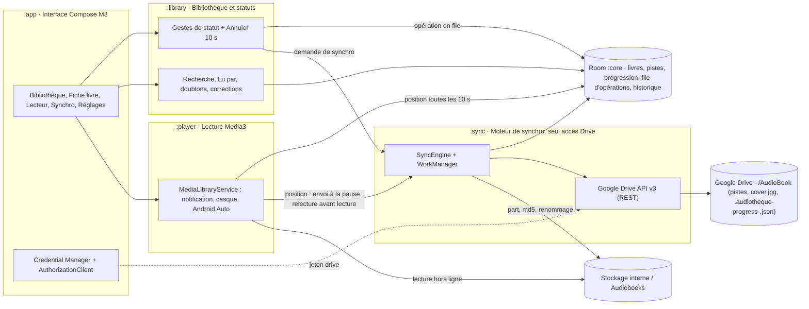
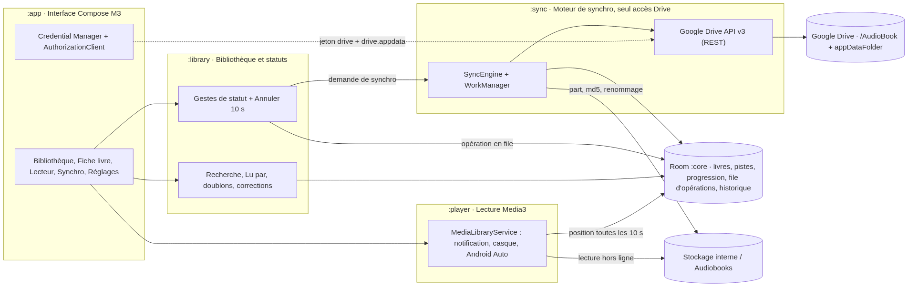
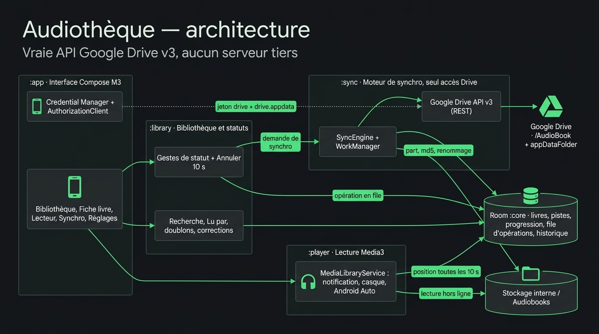

# Audiothèque

Application Android (Kotlin) qui remplace le duo « synchro Drive générique + lecteur » : elle connaît les
dossiers de statut de `/AudioBook` sur Google Drive, télécharge le livre en cours, le lit hors ligne et
range les livres d'un geste — chaque geste déplace le dossier du livre dans Drive.

Implémentation de la spécification
[`Spécification — App de synchro et lecture d’audiobooks.md`](Spécification%20—%20App%20de%20synchro%20et%20lecture%20d’audiobooks.md)
(MVP, v2 et v3).

L'app travaille uniquement sur la vraie bibliothèque : elle appelle l'API Google Drive v3 depuis le
téléphone, avec le compte Google connecté. Aucun Drive simulé, aucune bibliothèque ni piste fictive
n'est livrée dans l'app.

## Démarrage rapide

Prérequis : Android Studio (JDK 21 fourni), SDK Android 36, un téléphone Android 13+ et la
configuration Google Cloud ci-dessous (sans elle, la connexion Google échoue).

```bash
export JAVA_HOME="/Applications/Android Studio.app/Contents/jbr/Contents/Home"   # macOS
./gradlew assembleRelease        # APK : app/build/outputs/apk/release/app-release.apk
./gradlew testDebugUnitTest      # tests unitaires
adb install -r app/build/outputs/apk/release/app-release.apk
```

Au premier lancement : **Se connecter avec Google**, choisir le compte qui possède `/AudioBook`
et accepter l'autorisation Drive. La première synchro fait
l'inventaire complet des dossiers de statut et télécharge `_En écoute`.

Parcours du critère de sortie du MVP : onglet *En écoute* → ▶ *Civilisations* → écoute jusqu'au
bout → « Marquer comme écouté » → le dossier passe dans `_Ecouté` sur Drive (Synchro › Historique :
« Déplacement Drive ») sans ouvrir Drive.

## Configuration Google (vraie bibliothèque)

L'app appelle directement Google Drive API v3 depuis le téléphone : aucun serveur tiers. Google
n'accepte une app Android que si elle est déclarée dans un projet Google Cloud ; tant que ce n'est
pas fait, l'écran d'autorisation Google se referme aussitôt et l'app affiche « L'autorisation Google
Drive n'a pas abouti », avec le nom de paquet et l'empreinte SHA-1 à déclarer (bouton « Copier »).

À faire une fois, avec le compte Google qui possède `/AudioBook` (de préférence un projet personnel,
hors organisation) :

1. **Activer Google Drive API** :
   [console.cloud.google.com/apis/library/drive.googleapis.com](https://console.cloud.google.com/apis/library/drive.googleapis.com).
2. **Écran de consentement OAuth** ([Google Auth Platform](https://console.cloud.google.com/auth/overview)) :
   audience *Externe*, statut *Test* ; ajouter les comptes autorisés comme **utilisateurs test**
   (Julien, et Julie et Clément s'ils utilisent l'app). Accès aux données :
   `https://www.googleapis.com/auth/drive` (déplacer des dossiers que l'app n'a pas créés, écrire
   la progression et la pochette dans le dossier de chaque livre).
3. **ID client OAuth de type Android** ([Clients › Créer](https://console.cloud.google.com/auth/clients/create)) :
   nom de paquet `com.julienmiquel.audiotheque` et empreinte SHA-1 du certificat de signature. Les
   builds debug et release sont signés avec la clé de debug (usage personnel, APK installé à la main) :
   une seule empreinte suffit. Elle est affichée par l'app en cas d'échec, ou par :
   ```bash
   keytool -list -v -keystore ~/.android/debug.keystore -alias androiddebugkey -storepass android -keypass android | grep SHA1
   ```
4. **Facultatif — ID client de type « Application Web »** pour Credential Manager (bouton
   « Se connecter avec Google » natif). Le copier dans `local.properties` :
   ```properties
   audiotheque.webClientId=1234567890-xxxx.apps.googleusercontent.com
   ```
   Sans lui, le compte est choisi directement à l'écran d'autorisation Drive (AuthorizationClient).
5. **Facultatif — Google Images pour les pochettes introuvables.** Les pochettes viennent d'abord
   de Google Books, d'Apple Books (catalogue des livres audio) et d'Open Library, sans clé. Pour
   ajouter la recherche d'images Google en dernier recours : créer un
   [moteur de recherche programmable](https://programmablesearchengine.google.com/) réglé sur
   « Rechercher sur l'ensemble du Web » avec la **recherche d'images** activée, activer
   [Custom Search API](https://console.cloud.google.com/apis/library/customsearch.googleapis.com)
   et créer une clé d'API (100 requêtes gratuites par jour), puis :
   ```properties
   audiotheque.customSearchKey=AIza...
   audiotheque.customSearchCx=0123456789abcdef0
   ```
   Sans ces deux lignes, la source est simplement absente ; le menu de la fiche livre propose de
   toute façon « Chercher la pochette sur Google Images » (dans le navigateur) et « Choisir une
   image dans mes photos… » (Google Photos ou galerie).

Aucune réinstallation n'est nécessaire après les étapes 1 à 4 : il suffit de toucher à nouveau « Se
connecter avec Google » (la prise en compte par Google peut prendre quelques minutes).

Notes :

- En statut *En test*, Google peut demander de renouveler l'autorisation au bout de quelques jours :
   l'app affiche alors une seule fois la notification « Connexion Google à renouveler » et, dans l'app,
   un bandeau « Autorisation Google Drive à renouveler » au-dessus des onglets. Son bouton
   **Renouveler** rouvre l'écran d'autorisation Google sans se déconnecter ni rien effacer. L'app
   n'insiste pas en arrière-plan : les gestes restent en file et partent dès le renouvellement. Une
   autorisation donnée pour un autre compte est refusée.
- Une publication sur le Play Store imposerait la vérification Google du champ `drive` (restreint) :
   hors sujet pour un APK personnel (cf. questions ouvertes).
- Pour enregistrer les livres dans **[Stockage interne]/Audiobooks** comme l'app actuelle, accorder
   « Accès à tous les fichiers » (Réglages › Stockage, ou Synchro › Dossiers synchronisés). Sans cette autorisation,
   les livres vont dans le dossier de l'app (`Android/data/com.julienmiquel.audiotheque/files/Audiobooks`).

## Android Auto et vignette de reprise

L'app est un `MediaLibraryService` (Media3) : la voiture, l'Assistant et les Réglages rapides
n'ont rien à configurer, mais **un APK installé à la main n'apparaît dans Android Auto qu'en mode
développeur** : ouvrir l'app *Android Auto* sur le téléphone (Paramètres › Appareils connectés ›
Android Auto), toucher dix fois le numéro de *Version* pour activer les paramètres développeur,
puis ⋮ › *Paramètres développeur* › cocher **Sources inconnues**. Relancer Android Auto :
« Audiothèque » figure dans le lanceur de la voiture.

| Où | Ce que propose l'app |
| :--- | :--- |
| Lanceur Android Auto | Onglets **En écoute** et **Plus tard** (ce dernier seulement s'il a de quoi écouter) : grille de pochettes avec barre d'avancement et badge « téléchargé » ; seuls les livres ayant des pistes sur le téléphone sont proposés — la lecture reste hors ligne, jamais en streaming |
| Un livre | Toucher reprend la lecture à la position gardée (après relecture de la position Drive, 4 s au plus) ; le chevron ouvre les **chapitres groupés par partie**, avec l'avancement de chacun |
| Lecture en cours | **« Piste 4 / 51 » (ou « Chapitre 4 ») puis le titre du livre** — jamais le nom de fichier ni l'auteur en première ligne (l'auteur reste en 3ᵉ ligne / album) ; pochette ; **⏮/⏭ = chapitre précédent/suivant** (boutons standards, visibles partout), puis **−30 s / +30 s** (pas réglable) et **Vitesse** (un appui : 1,0 → 1,2 → 1,5 → 2,0 → 0,8×, mémorisée par livre) en boutons supplémentaires ; file d'attente = chapitres |
| Recherche et voix | « Écoute *Civilisations* », « Lis le livre de *Laurent Binet* », « Reprends mon livre » : titre, auteur ou voix, mots de remplissage ignorés ; sans mots, le dernier livre écouté |
| Réglages rapides, écran verrouillé | Pendant l'écoute : « Piste 4 / 51 » / titre du livre, ⏮ ▶ ⏭ −30 +30. Après l'arrêt de l'app ou un redémarrage, la **vignette de reprise** affiche le dernier livre écouté avec sa pochette et où il reprend (« Piste 4 / 51 · 42 % »). Elle démarre aussitôt à la position locale, puis saute à celle de l'autre téléphone si Drive en a une plus récente (message « Position reprise depuis… » dans l'app) |
| Montre Wear OS, casque Bluetooth, autoradio | ▶/⏸ et ⏮/⏭ (chapitres) fonctionnent sur tous ces contrôleurs : les sauts de 30 s ne prennent pas la place des boutons standards (sinon Media3 retire ⏮/⏭ de la session système et la montre n'a plus qu'un ▶ figé). Le bouton ▶ relance le dernier livre même si le service a été arrêté ; pochette et titres via AVRCP |

Les pochettes sont servies aux autres processus (voiture, System UI) par un fournisseur de
contenu en lecture seule, non exporté : le service accorde le droit de lecture à chaque application
qui se connecte ([CoverArtProvider.kt](player/src/main/java/com/julienmiquel/audiotheque/player/CoverArtProvider.kt)).

## Préréglages audio et confort d'écoute

Lecteur › **Son** (ou Réglages › Lecture) : un traitement du signal appliqué à la lecture, au choix
**pour tous les livres** ou **mémorisé livre par livre** (synchronisé sur Drive entre vos appareils),
aussi en voiture et sur la montre. Il s'insère dans la chaîne audio d'ExoPlayer avant le changement de
vitesse ([PresetAudioProcessor.kt](player/src/main/java/com/julienmiquel/audiotheque/player/audio/PresetAudioProcessor.kt)),
change sans coupure pendant l'écoute (fondu de 15 ms) et repart à zéro à chaque saut. Les blocs
([Dsp.kt](player/src/main/java/com/julienmiquel/audiotheque/player/audio/Dsp.kt)) sont en Kotlin pur,
assemblés par préréglage dans [PresetChain.kt](player/src/main/java/com/julienmiquel/audiotheque/player/audio/PresetChain.kt).

| Préréglage | Chaîne | Pour |
| :--- | :--- | :--- |
| Son d'origine | — | Le fichier tel quel |
| Volume constant | Compression 2,5:1 à −18 dBFS → normalisation automatique vers −18 dBFS RMS (+14 dB au plus, figée sous −55 dBFS) → limiteur −1 dB | Même niveau d'un chapitre et d'un livre à l'autre |
| Voix renforcée | Chaîne vocale « Netophonix » : coupe-bas 80 Hz → présence +3 dB à 3,5 kHz (Q 0,7) → compression 3:1 à −20 dBFS (5 ms / 50 ms) → normalisation vers −20 dBFS → limiteur | Voiture, bruit : articulation plus nette |
| Niveau très bas | Compression 4:1 à −30 dBFS → normalisation vers −20 dBFS → limiteur → **−12 dB** en sortie | Écoute au casque à très faible volume (nuit) : les murmures restent audibles, le volume minimal devient vraiment bas |
| Binaural (casque) | Chaîne vocale, puis la voix (mono) placée **dans une pièce** : modèle de tête de Brown & Duda (délai interaural de Woodworth, ombre de la tête par oreille), six premières réflexions filtrées, réverbération de Schroeder, limiteur | Son « hors de la tête », moins fatigant au casque ; **position de la voix** (−30° à +30°) et **acoustique** (*Intime*, *Petite pièce*, *Salon*) réglables |

Confort d'écoute complémentaire :
- **Saut des silences** (`skipSilenceEnabled`) activable d'un geste dans *Son* ou *Réglages › Lecture*.
- **Minuterie de sommeil avancée** : durées prédéfinies, durée libre (5 à 120 min), arrêt en fin de chapitre, **fondu sonore progressif de 10 s** avant la pause et **secousse du téléphone (+10 min)** active uniquement pendant la minuterie (et 60 s après l'arrêt automatique).
- **Recul intelligent à la reprise** : recul adapté à la durée d'interruption (0 s sous 2 s, 2 s sous 1 min, 5 s sous 10 min, 10 s sous 1 h, 20 s sous 24 h, 30 s au-delà).
- **Positions récentes (annuler un saut)** : historique automatique avant chaque saut de chapitre, déplacement du curseur, signet ou minuterie.
- **Chapitres intégrés `.m4b` / `.m4a` et ID3 `CHAP`** : lecture directe des boîtes ISO BMFF (`chpl` Nero et piste texte QuickTime `tref/chap`, même lorsque `moov` est en fin de fichier) et découpage par chapitre dans le lecteur et Android Auto.

## Architecture

Trois modules métier partagent une base Room ; **seul `:sync` parle à Drive**, ce qui rend les gestes
utilisables hors ligne (file d'opérations rejouée au retour du réseau).



| Rendu exact du diagramme | Vue d'ensemble |
| :---: | :---: |
|  |  |

| Module | Rôle | Fichiers clés |
| :--- | :--- | :--- |
| `:core` | Base Room (livres, pistes, chapitres intégrés, progression, sessions d'écoute, signets, historique, synchros, file d'opérations, paires), réglages DataStore, découpage et normalisation des noms de dossiers (`Titre - AUTEUR`), détection des séries et tomes (`Fondation · T.1`), filtrage des noms de pistes redondants, lecture des premiers Ko d'un mp3/m4b (ID3, CHAP, ISO BMFF, débit), mise en forme française | [Entities.kt](core/src/main/java/com/julienmiquel/audiotheque/core/db/Entities.kt), [FolderNameParser.kt](core/src/main/java/com/julienmiquel/audiotheque/core/parse/FolderNameParser.kt), [TrackNameParser.kt](core/src/main/java/com/julienmiquel/audiotheque/core/parse/TrackNameParser.kt), [Mp3Probe.kt](core/src/main/java/com/julienmiquel/audiotheque/core/parse/Mp3Probe.kt), [Mp4Probe.kt](core/src/main/java/com/julienmiquel/audiotheque/core/parse/Mp4Probe.kt) |
| `:library` | Gestes de statut et renommage normalisé (`Titre - AUTEUR`) mis en file + « Annuler » 10 s, déplacement vers n'importe quel statut, corrections titre/auteur/voix, recommandations locales « À écouter ensuite », recherche (titre, auteur, série, voix), tri multicritère (ajout, écoute récente, titre/série, auteur, durée), filtres « Hors ligne » et « Lu par », statistiques d'écoute et séries quotidiennes, export/import JSON local, doublons et leur suppression (corbeille Drive, par la file d'opérations), pochette et résumé en ligne | [Library.kt](library/src/main/java/com/julienmiquel/audiotheque/library/Library.kt), [ListeningStats.kt](library/src/main/java/com/julienmiquel/audiotheque/library/ListeningStats.kt), [BackupManager.kt](library/src/main/java/com/julienmiquel/audiotheque/library/BackupManager.kt), [BookRecommender.kt](library/src/main/java/com/julienmiquel/audiotheque/library/BookRecommender.kt), [GoogleBooks.kt](library/src/main/java/com/julienmiquel/audiotheque/library/GoogleBooks.kt) |
| `:sync` | Client Google Drive API v3 (REST), inventaire complet puis flux de modifications, file d'opérations (déplacements, renommages, corbeille) avec nouvelles tentatives espacées, téléchargements (3 en parallèle, `.part`, Range, taille + md5), décompression et inspection hors ligne des archives `.zip`, nettoyage par statut, progression dans le dossier Drive de chaque livre (envoi à la pause, relecture avant lecture), dépôt des pochettes téléchargées, WorkManager | [SyncEngine.kt](sync/src/main/java/com/julienmiquel/audiotheque/sync/engine/SyncEngine.kt), [ZipExtractor.kt](sync/src/main/java/com/julienmiquel/audiotheque/sync/engine/ZipExtractor.kt), [ProgressSync.kt](sync/src/main/java/com/julienmiquel/audiotheque/sync/engine/ProgressSync.kt), [Covers.kt](sync/src/main/java/com/julienmiquel/audiotheque/sync/engine/Covers.kt), [Transfers.kt](sync/src/main/java/com/julienmiquel/audiotheque/sync/engine/Transfers.kt), [RestDriveService.kt](sync/src/main/java/com/julienmiquel/audiotheque/sync/drive/RestDriveService.kt) |
| `:player` | Media3 ExoPlayer + MediaLibraryService : reprise intelligente selon la durée d'absence, sauvegarde toutes les 10 s et à chaque pause, enregistrement précis des sessions d'écoute actives, position envoyée dans Drive à la pause et relue avant la lecture (continuer sur l'autre téléphone), saut réglable et historique des sauts, vitesse et préréglage audio par livre, saut des silences, minuterie avancée (fondu 10 s + secousse +10 min), fin du livre, notification, écran verrouillé, casque ; catalogue Android Auto (onglets, grille de pochettes, chapitres par partie, recherche vocale, bouton Vitesse), vignette de reprise du système, pochettes servies par un fournisseur de contenu ; préréglages audio (normalisation, voix, niveau très bas, binaural) dans la chaîne ExoPlayer | [PlaybackService.kt](player/src/main/java/com/julienmiquel/audiotheque/player/PlaybackService.kt), [AutoCatalog.kt](player/src/main/java/com/julienmiquel/audiotheque/player/AutoCatalog.kt), [Dsp.kt](player/src/main/java/com/julienmiquel/audiotheque/player/audio/Dsp.kt), [CoverArtProvider.kt](player/src/main/java/com/julienmiquel/audiotheque/player/CoverArtProvider.kt), [PlayerConnection.kt](player/src/main/java/com/julienmiquel/audiotheque/player/PlayerConnection.kt) |
| `:app` | Interface Compose Material 3 (thème sombre à accent vert, thème clair en option), navigation à 3 onglets + **mini-lecteur persistant** (Bibliothèque, Fiche livre, Synchro, Réglages, Statistiques), vue liste ou grille de pochettes, écran **Statistiques d'écoute**, sauvegarde/restauration JSON, widget d'écran d'accueil Android (pochette, avancement, −saut / ▶/⏸ / +saut), connexion Google | [AudiothequeRoot.kt](app/src/main/java/com/julienmiquel/audiotheque/ui/AudiothequeRoot.kt), [MiniPlayerBar.kt](app/src/main/java/com/julienmiquel/audiotheque/ui/player/MiniPlayerBar.kt), [StatsScreen.kt](app/src/main/java/com/julienmiquel/audiotheque/ui/stats/StatsScreen.kt), [AudiothequeWidgetProvider.kt](app/src/main/java/com/julienmiquel/audiotheque/widget/AudiothequeWidgetProvider.kt), [AudiothequeApp.kt](app/src/main/java/com/julienmiquel/audiotheque/AudiothequeApp.kt) |

### Correspondance avec la spécification

| Spécification | Implémentation |
| :--- | :--- |
| Statut = dossier parent ; un geste = un déplacement | `StatusGestures` écrit l'opération en base et le statut « en attente » ; `OperationExecutor` appelle `files.update` (`addParents` / `removeParents`) |
| Bandeau « Annuler » 10 s | Snackbar `SnackbarDuration.Long` (10 s) après chaque geste ou renommage ([AudiothequeRoot.kt](app/src/main/java/com/julienmiquel/audiotheque/ui/AudiothequeRoot.kt)). « Annuler » remet le livre dans son dossier ou son nom de départ et rétablit la progression modifiée par le geste, même si l'opération était déjà en cours |
| Drive fait foi | Flux de modifications : un dossier déplacé ou renommé ailleurs met à jour l'état local ; un geste encore en file n'écrase pas ce changement externe : il est abandonné et signalé dans l'historique |
| Un échec ne modifie pas l'état local | Statut et nom confirmés distincts des valeurs en attente ; refus définitif → opération abandonnée (un « Marquer écouté » refusé ne laisse pas « terminé ») ; nouvel essai espacé (30 s, 1 min, 2 min… 1 h), jamais en boucle si l'autorisation Google est à renouveler |
| Seul `_En écoute` descend en entier (dossiers et `.zip`) | `Downloader.plan()` & `Downloader.zipPlan()` ; les archives `.zip` de `_En écoute` sont téléchargées avec reprise HTTP `Range` + vérification MD5, décompressées sur le téléphone (encodages UTF-8 et CP437/Windows-1252, protection Zip-Slip, inspection des pistes et pochette intégrée) puis l'archive `.part` est supprimée ; Nouveaux : métadonnées (+ 1ʳᵉ piste si « Aperçu ») ; Plus tard 7 j, Écouté 24 h ([CleanupPolicy.kt](core/src/main/java/com/julienmiquel/audiotheque/core/model/CleanupPolicy.kt)) |
| Renommage normalisé sur Drive (optionnel) | Fiche livre › ⋮ › « Normaliser le nom sur Drive… » (ou case à cocher dans « Corriger le titre ou l'auteur ») : renomme le dossier ou le `.zip` selon `Titre - AUTEUR` via la file d'opérations hors ligne (`RENAME_BOOK`), avec « Annuler » 10 s |
| Suggestions « À écouter ensuite » | `BookRecommender` : classement local sur l'appareil (affinité auteur/voix avec les livres terminés ou en cours, livres commencés dans *Plus tard*, durée proche de vos habitudes, disponibilité hors ligne) affiché en tête de *Nouveaux* et à la fin d'un livre |
| Ergonomie bibliothèque : tri, grille, hors-ligne, séries | Barre rapide dans la Bibliothèque : filtre **Hors ligne** en un geste, filtre **Voix**, **tri multicritère** (par défaut, écoutés récemment, ajout récent, titre/série A→Z, auteur A→Z, durée croissante/décroissante), bascule **liste / grille de pochettes**, et reconnaissance automatique des **séries et numéros de tome** (`[Les Rois maudits 2]`, `Tome 1`, `Millénium 1 - …`) regroupés dans l'ordre des volumes |
| Mini-lecteur persistant | `MiniPlayerBar` ancré au-dessus de la barre de navigation sur tous les écrans hors Lecteur : barre d'avancement en direct, pochette, titre, chapitre et pourcentage, recul rapide (−30 s) et lecture/pause |
| Statistiques d'écoute & Sauvegarde JSON | `StatsScreen` (temps d'écoute aujourd'hui / 7 j / 30 j / total, séries de jours consécutifs actuelle et record, histogramme interactif 7 j / 30 j, livres terminés, top livres, auteurs et narrateurs) ; `BackupManager` (export et restauration JSON non destructifs des progressions, signets, corrections locales, vitesses/préréglages par livre et sessions d'écoute, sans modifier Google Drive) |
| Widget d'écran d'accueil | `AudiothequeWidgetProvider` (4×1 redimensionnable) : pochette, titre, chapitre et pourcentage, barre d'avancement, recul, lecture/pause et avance rapide sans réveiller le service en arrière-plan |
| Archives, méditations, racine : à l'ouverture | Noms des livres listés à l'inventaire (une requête par dossier, pour que la recherche couvre toute la bibliothèque) ; pistes, durées et pochettes lues à l'ouverture de l'onglet |
| Inventaire complet à la 1ʳᵉ synchro puis chaque semaine | `LibraryScanner.scan` (`changes.getStartPageToken` / `changes.list` entre-temps) |
| 6 h, Wi-Fi seul, batterie non faible ; synchro au lancement et à chaque geste | `SyncScheduler` (WorkManager), réglable dans Synchro › Dossiers synchronisés. En « Wi-Fi uniquement », sur réseau mesuré, téléchargements, échantillons audio et pochettes attendent le Wi-Fi : une synchro repart à son retour |
| 3 téléchargements, reprise, ordre depuis la position, `.part` + taille + md5, espace + 500 Mo | `Downloader` ; les pistes de `_En écoute` sont listées et téléchargées avant les métadonnées du reste de la bibliothèque |
| Historique 30 jours filtrable par livre | `HistoryLogger`, Synchro › Historique |
| Lecteur : reprise, chapitres par partie, ±30 s, vitesse 0,8–2,0, minuterie, signets, avancement | [PlayerScreen.kt](app/src/main/java/com/julienmiquel/audiotheque/ui/player/PlayerScreen.kt), `PlaybackService` ; masquage automatique des noms de fichiers redondants (`01 - Civilisations.mp3`, `Track 03`) au profit de vrais titres de chapitres ; ouvrir un livre sans l'écouter n'enregistre rien (pas de recul cumulé). En plus de la spécification : préréglages audio (bouton Son, mémorisables par livre) et une **barre du chapitre en cours** (écoulé, restant, déplaçable) au-dessus de la barre du livre entier, qui est **en lecture seule** — un effleurement ne peut pas faire sauter dix heures d'écoute ; seule la barre du chapitre et les boutons déplacent la lecture |
| Position conservée dans tous les statuts | « Réécouter » repart du début d'un livre fini, garde la position sinon |
| Fin du livre : proposer « Marquer comme écouté » sans rien déplacer seul | Dialogue (avec suggestions « À écouter ensuite ») + carte persistante dans le lecteur et la fiche (aussi avec la minuterie « fin du chapitre » sur le dernier chapitre) |
| Progression par utilisateur, d'un téléphone à l'autre | `ProgressSync` : un petit JSON **dans le dossier Drive du livre** (ou le dossier parent pour une archive `.zip`), un par compte (`.audiotheque-progress-<compte>.json`, visible dans Drive, suit le livre quand il change de statut). **La position enregistrée le plus récemment l'emporte, dans les deux sens** : une position locale plus ancienne ne peut pas écraser celle de l'autre téléphone. Le lecteur l'**envoie à chaque pause** (et toutes les 5 min pendant l'écoute) et la **relit juste avant de reprendre** un livre (4 s au plus), avec le message « Position reprise depuis Google Pixel 9 (42 %) » ; l'app la relit aussi au retour au premier plan et en fin de synchro. Dates « déjà vu » de Drive (pas l'horloge du téléphone) |
| Pochette et résumé | `Enricher` : Google Books (résumé + pochette, nouvelles tentatives espacées sur 429/5xx/réseau), puis **Apple Books** (catalogue des livres audio, pochettes 600 px, sans clé), Open Library, et **Google Images** en dernier recours si une clé Custom Search est configurée (voir Configuration). La recherche tourne pour **tous les dossiers qui ressemblent à un livre** (pas seulement les titres confirmés) : tant que le titre n'est pas confirmé, seule une correspondance nette du titre *et* de l'auteur connu est acceptée — jamais une pochette au hasard ; corriger ou confirmer le titre relance la recherche en mode souple. La pochette est **téléchargée une fois sur le téléphone** (plus de réseau à l'affichage) et **déposée dans le dossier Drive du livre** (`cover.jpg`) si celui-ci n'a pas d'image, pour les autres téléphones. À la main, depuis la fiche : « Chercher la pochette sur Google Images » (navigateur) ou « Choisir une image dans mes photos… » (sélecteur de photos : Google Photos, galerie ; image réduite à 1 200 px puis déposée dans Drive). Un service injoignable (ou un portail captif) n'est pas définitif : les livres sans pochette sont repris après chaque synchro, au retour au premier plan et à l'ouverture de la fiche (au plus une fois par demi-heure) |
| Durée exacte après téléchargement, sinon estimée par le débit | `MetadataProber.probe` (premiers Ko de la 1ʳᵉ piste) puis `MediaMetadataRetriever` |
| Voix lue dans les tags ID3 | `Id3Tags.narrator()` (TXXX, « lu par », compositeur) |
| Badge doublon | Même titre, sauf si les deux auteurs sont connus et diffèrent. La fiche liste les exemplaires et permet de **supprimer** celui qu'on ne garde pas : son dossier est mis à la **corbeille Drive** (`files.update {trashed:true}`, restaurable 30 jours depuis Drive, jamais de suppression définitive) par la file d'opérations, donc aussi hors ligne ; il disparaît aussitôt de la bibliothèque avec « Annuler » 10 s, ses pistes locales sont effacées quand Drive a confirmé. Refusé pour le livre en cours de lecture ; abandonné si le dossier a été déplacé hors de la bibliothèque entre-temps (Drive fait foi) |
| « Mettre de côté » (fiche livre, appui long dans la bibliothèque) | Le dossier passe dans `_A écouter plus tard` : lecture mise en pause, position gardée (« Reprendre » repart exactement là), avancement noté, pistes conservées 7 jours (réglable) sur le téléphone avant nettoyage. Pour interrompre un livre sans perdre sa place ni encombrer « En écoute ». L'écran d'écoute ne propose aucun bouton de rangement ; il n'affiche « Reprendre » ou « Commencer » que pour un livre qui n'est pas dans « En écoute » |
| Accessibilité | Descriptions TalkBack (interrupteurs, badge de synchro, boutons de vitesse, mini-lecteur, widget), erreurs signalées en toutes lettres, titres de section, tailles en `sp`, palettes M3 contrastées |

### Réponses retenues aux questions ouvertes (modifiables)

| Question | Choix de l'app |
| :--- | :--- |
| Julie et Clément | Progression propre à chaque compte (un fichier par compte dans le dossier du livre) ; les dossiers de statut restent partagés. Une paire par personne peut être ajoutée (paires illimitées) |
| Plusieurs livres dans `_En écoute` | Autorisé ; tous sont téléchargés, en commençant par le dernier écouté |
| Dossiers qui ne sont pas des livres | Fiche livre › « Ce n'est pas un livre (masquer) », ou « Déplacer vers… » `_archives`. L'onglet **Archives** (`_archives`, métadonnées à l'ouverture) est affiché par défaut ; Réglages › Bibliothèque permet de le masquer |
| Délais de nettoyage | 7 jours et 24 h par défaut, réglables (Réglages › Nettoyage) |
| Play Store ou APK personnel | APK personnel, accès Drive en mode test (voir ci-dessus) |
| *Les guerriers de l'hiver* | Sa progression (46 %) est conservée ; « Déplacer vers… » `_A écouter plus tard` ou « Réécouter » (qui reprend à 46 %) depuis la fiche |
| Déconnexion | La progression est d'abord écrite dans les dossiers Drive des livres, puis la bibliothèque locale et les pistes sont effacées ; progression (par compte), sessions d'écoute et signets restent sur le téléphone |

## Tests

```bash
./gradlew testDebugUnitTest
```

Suites de tests unitaires (JUnit, Robolectric, MockWebServer). Les doubles de test (Drive en mémoire,
serveur HTTP local) et les fichiers de `testdata/audio` n'existent que dans les tests : ils ne sont
pas compilés dans l'app, qui ne parle qu'à la vraie API Google Drive.

| Suite | Couverture |
| :--- | :--- |
| `core` · `FolderNameParserTest`, `TrackNameParserTest` | Toutes les anomalies de noms de la spécification, normalisation `Titre - AUTEUR`, détection des séries et tomes, filtrage des noms de pistes redondants, motif « 091_P4_04_… », ordre naturel |
| `core` · `Mp3ProbeTest`, `Mp4ProbeTest`, `ProgressMathTest` | Tags ID3, chapitres `CHAP` et boîtes ISO BMFF (`chpl`, `tref/chap`), pochette intégrée, durée par le débit, recul intelligent, formats français |
| `library` · `StatusGesturesTest`, `BookRecommenderTest`, `ListeningStatsTest`, `BackupManagerTest` | Gestes et renommages mis en file, « Annuler » (dossier/nom de départ, progression rétablie), gestes hors ligne, position gardée, « Réécouter », corrections, recommandations locales « À écouter ensuite », tri multicritère et séries, filtre hors ligne, séries de jours d'écoute et histogrammes 7j/30j, export/restauration JSON idempotent sans mutation Drive, doublons et corbeille Drive |
| `library` · `CoverEnrichmentTest` | Pochettes contre un serveur HTTP local : correspondance stricte sans titre confirmé, Google Books injoignable → Apple Books (pochette déposée dans Drive), pochette d'un autre livre refusée puis recherche relancée après confirmation du titre, image morte → source suivante, hors ligne et portail captif sans abandon, Google Images en dernier recours (format pochette), choix des dossiers qui méritent une recherche |
| `sync` · `SyncEngineTest`, `ZipExtractorTest` | Moteur contre un double de test de Drive : inventaire, téléchargements vérifiés, décompression `.zip` (accents UTF-8/CP437, Zip-Slip, pochette), renommage Drive normalisé et refus 403, Marquer écouté → `_Ecouté` puis nettoyage 24 h, Drive fait foi, « Annuler » pendant un déplacement, hors ligne, autorisation expirée sans boucle, Wi-Fi uniquement, reprise Range, progression inter-appareils (dossiers et `.zip`), doublon mis à la corbeille Drive |
| `sync` · `RestDriveServiceTest` | Chaque appel du tableau Drive API v3 contre un serveur HTTP local (MockWebServer), jeton renouvelé, limites de débit |
| `player` · `PlayerLogicTest`, `AutoCatalogTest`, `PresetChainTest` | Identifiants média, chapitres intégrés et par partie, minuterie et fondu, bornes de vitesse, catalogue Android Auto et recherche vocale, chaîne DSP complète (coupe-bas, présence, compresseur, normalisation, niveau très bas, binaural) |

## Hors périmètre

Envoi de livres depuis le téléphone, fichiers Audible (AAX), iOS.
