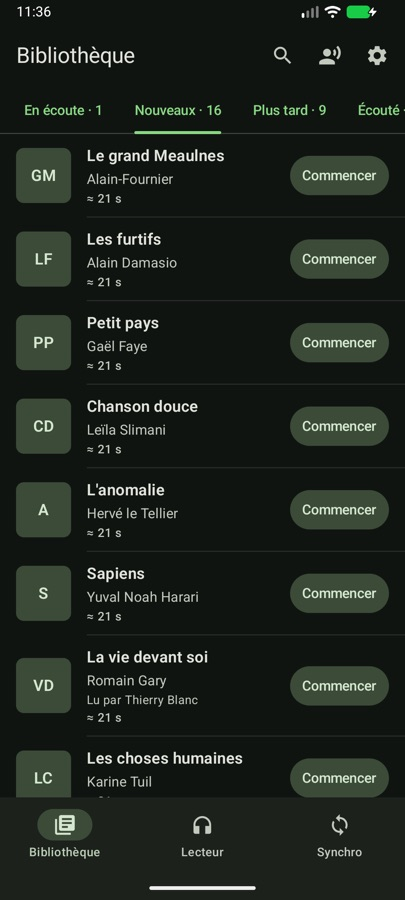
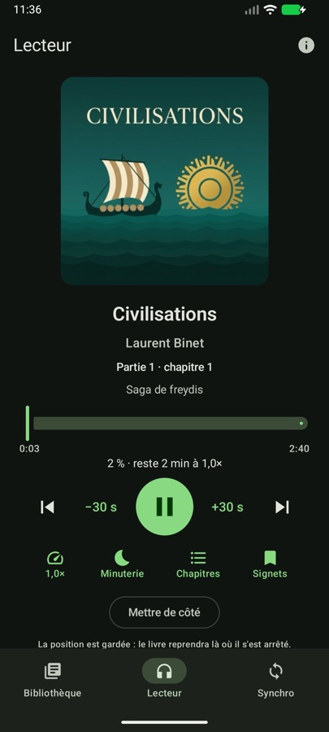
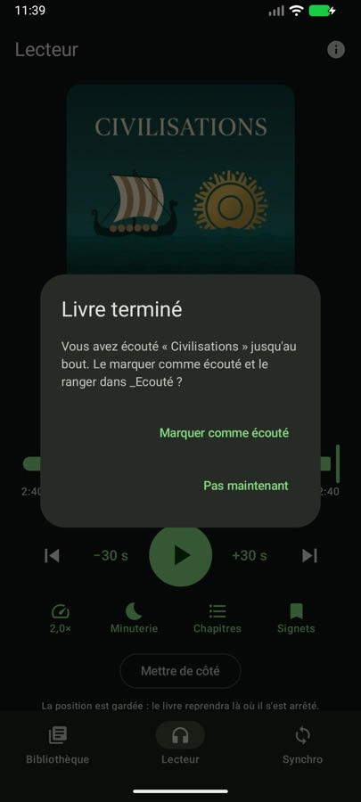
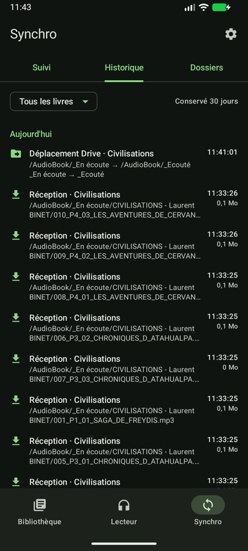
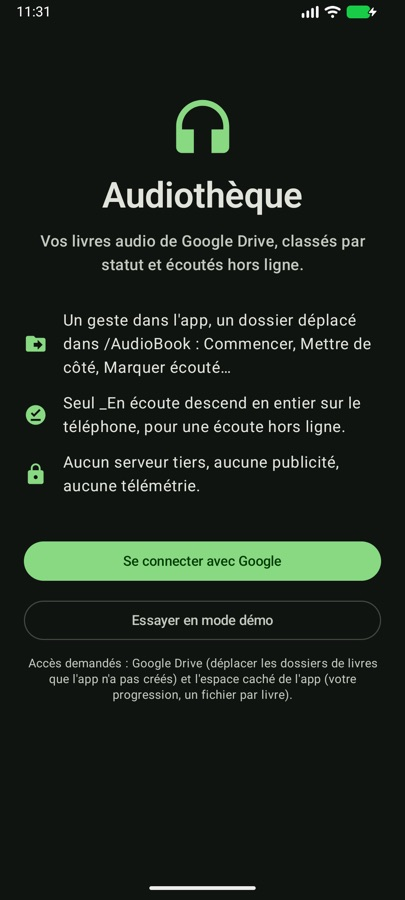
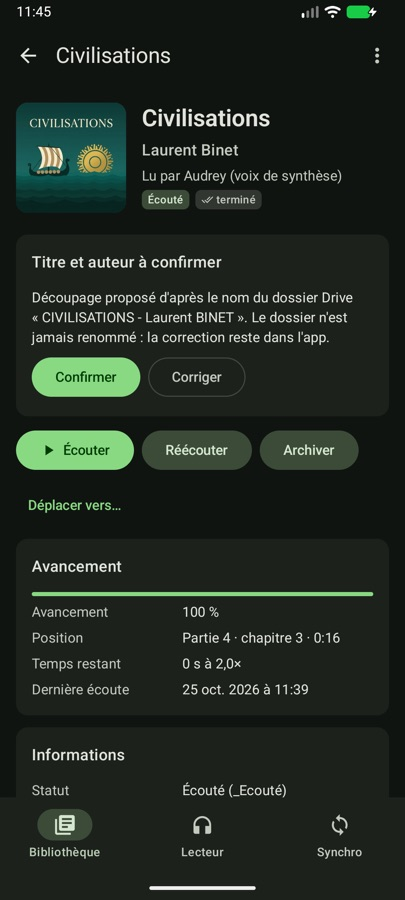
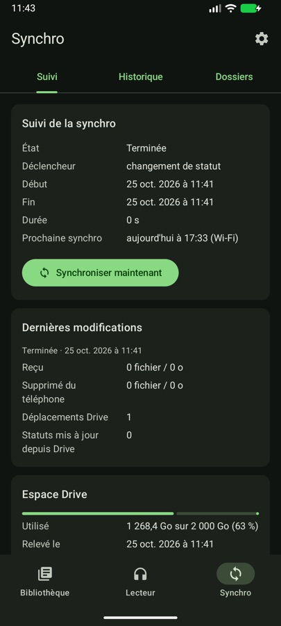
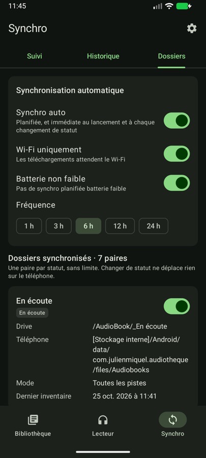
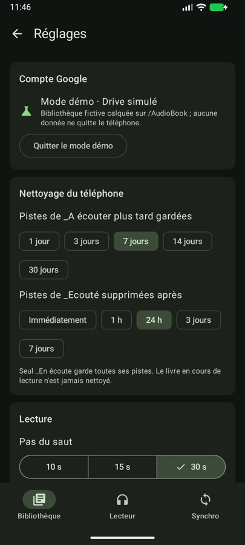
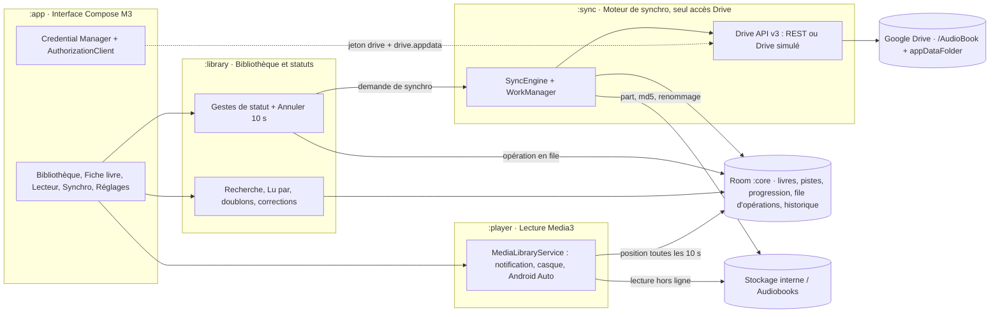

# Audiothèque

Application Android (Kotlin) qui remplace le duo « synchro Drive générique + lecteur » : elle connaît les
dossiers de statut de `/AudioBook` sur Google Drive, télécharge le livre en cours, le lit hors ligne et
range les livres d'un geste — chaque geste déplace le dossier du livre dans Drive.

Implémentation de la spécification
[`Spécification — App de synchro et lecture d’audiobooks.md`](Spécification%20—%20App%20de%20synchro%20et%20lecture%20d’audiobooks.md)
(MVP et v2).

| Bibliothèque | Lecteur | Fin du livre | Synchro › Historique |
| :---: | :---: | :---: | :---: |
|  |  |  |  |

| Accueil | Fiche livre | Synchro › Suivi | Dossiers synchronisés | Réglages |
| :---: | :---: | :---: | :---: | :---: |
|  |  |  |  |  |

## Démarrage rapide

Prérequis : Android Studio (JDK 21 fourni), SDK Android 36, un téléphone ou émulateur Android 13+.

```bash
export JAVA_HOME="/Applications/Android Studio.app/Contents/jbr/Contents/Home"   # macOS
./gradlew assembleDebug          # APK : app/build/outputs/apk/debug/app-debug.apk
./gradlew testDebugUnitTest      # tests unitaires des 5 modules
adb install -r app/build/outputs/apk/debug/app-debug.apk
```

Au premier lancement, deux choix :

- **Essayer en mode démo** : un Drive simulé reproduit la bibliothèque du 25/10/2026 (dossiers de
  statut et leurs IDs, *Civilisations* dans `_En écoute`, 16 Nouveaux, doublons, zip, piste isolée,
  dossiers qui ne sont pas des livres, *Les guerriers de l'hiver* rangé à tort dans `_Ecouté` avec sa
  progression à 46 %). Les pistes sont de courts mp3 de démonstration (voix de synthèse, textes
  originaux qui présentent l'app ; le livre lui-même n'est pas inclus). Aucune donnée ne quitte le
  téléphone.
- **Se connecter avec Google** : la vraie bibliothèque, après la configuration Google Cloud ci-dessous.

Parcours du critère de sortie du MVP en mode démo : onglet *En écoute* → ▶ *Civilisations* → écoute
jusqu'au bout (2 min 40, ou 1 min 20 à 2,0×) → « Marquer comme écouté » → le dossier passe dans
`_Ecouté` (Synchro › Historique : « Déplacement Drive ») sans ouvrir Drive.

## Configuration Google (vraie bibliothèque)

L'app appelle directement Google Drive API v3 depuis le téléphone : aucun serveur tiers.

1. **Projet Google Cloud** : créer un projet, activer **Google Drive API**.
2. **Écran de consentement OAuth** : type *Externe*, statut *En test* ; ajouter les comptes autorisés
   comme utilisateurs test (Julien, et Julie et Clément s'ils utilisent l'app). Champs d'application :
   `https://www.googleapis.com/auth/drive` (déplacer des dossiers que l'app n'a pas créés) et
   `https://www.googleapis.com/auth/drive.appdata` (progression).
3. **ID client OAuth de type Android** : nom de paquet `com.julienmiquel.audiotheque` et empreinte SHA-1
   de la clé de signature. Les builds debug et release sont signés avec la clé de debug (usage
   personnel, APK installé à la main), une seule empreinte suffit :
   ```bash
   keytool -list -v -keystore ~/.android/debug.keystore -alias androiddebugkey -storepass android -keypass android | grep SHA1
   ```
4. **Facultatif — ID client de type « Application Web »** pour Credential Manager (bouton
   « Se connecter avec Google » natif). Le copier dans `local.properties` :
   ```properties
   audiotheque.webClientId=1234567890-xxxx.apps.googleusercontent.com
   ```
   Sans lui, le compte est choisi directement à l'écran d'autorisation Drive (AuthorizationClient).

Notes :

- En statut *En test*, Google peut demander de renouveler l'autorisation au bout de quelques jours :
  l'app affiche alors la notification « Connexion Google à renouveler ».
- Une publication sur le Play Store imposerait la vérification Google du champ `drive` (restreint) :
  hors sujet pour un APK personnel (cf. questions ouvertes).
- Pour enregistrer les livres dans **[Stockage interne]/Audiobooks** comme l'app actuelle, accorder
  « Accès à tous les fichiers » (Réglages › Stockage, ou Synchro › Dossiers). Sans cette autorisation,
  les livres vont dans le dossier de l'app (`Android/data/com.julienmiquel.audiotheque/files/Audiobooks`).

## Architecture

Trois modules métier partagent une base Room ; **seul `:sync` parle à Drive**, ce qui rend les gestes
utilisables hors ligne (file d'opérations rejouée au retour du réseau).



| Rendu exact du diagramme | Vue d'ensemble |
| :---: | :---: |
|  |  |

| Module | Rôle | Fichiers clés |
| :--- | :--- | :--- |
| `:core` | Base Room (livres, pistes, progression, signets, historique, synchros, file d'opérations, paires), réglages DataStore, découpage des noms de dossiers et de pistes, lecture des premiers Ko d'un mp3 (ID3, débit), mise en forme française | [Entities.kt](core/src/main/java/com/julienmiquel/audiotheque/core/db/Entities.kt), [FolderNameParser.kt](core/src/main/java/com/julienmiquel/audiotheque/core/parse/FolderNameParser.kt), [TrackNameParser.kt](core/src/main/java/com/julienmiquel/audiotheque/core/parse/TrackNameParser.kt), [Mp3Probe.kt](core/src/main/java/com/julienmiquel/audiotheque/core/parse/Mp3Probe.kt) |
| `:library` | Gestes de statut mis en file + « Annuler », déplacement vers n'importe quel statut, corrections titre/auteur/voix (le dossier n'est jamais renommé), recherche, filtre « Lu par », doublons, Google Books | [Library.kt](library/src/main/java/com/julienmiquel/audiotheque/library/Library.kt), [GoogleBooks.kt](library/src/main/java/com/julienmiquel/audiotheque/library/GoogleBooks.kt) |
| `:sync` | Client Drive v3 (REST) et Drive simulé, inventaire complet puis flux de modifications, file de déplacements avec nouvelles tentatives espacées, téléchargements (3 en parallèle, `.part`, Range, taille + md5), nettoyage par statut, progression dans `appDataFolder`, WorkManager | [SyncEngine.kt](sync/src/main/java/com/julienmiquel/audiotheque/sync/engine/SyncEngine.kt), [Transfers.kt](sync/src/main/java/com/julienmiquel/audiotheque/sync/engine/Transfers.kt), [RestDriveService.kt](sync/src/main/java/com/julienmiquel/audiotheque/sync/drive/RestDriveService.kt), [SyncWork.kt](sync/src/main/java/com/julienmiquel/audiotheque/sync/work/SyncWork.kt) |
| `:player` | Media3 ExoPlayer + MediaLibraryService : reprise −5 s, sauvegarde toutes les 10 s et à chaque pause, saut réglable, vitesse par livre, minuterie, fin du livre, notification, écran verrouillé, casque, Android Auto | [PlaybackService.kt](player/src/main/java/com/julienmiquel/audiotheque/player/PlaybackService.kt), [PlayerConnection.kt](player/src/main/java/com/julienmiquel/audiotheque/player/PlayerConnection.kt) |
| `:app` | Interface Compose Material 3 (thème sombre à accent vert, thème clair en option), navigation à 3 onglets, connexion Google | [AudiothequeRoot.kt](app/src/main/java/com/julienmiquel/audiotheque/ui/AudiothequeRoot.kt), [AudiothequeApp.kt](app/src/main/java/com/julienmiquel/audiotheque/AudiothequeApp.kt) |

### Correspondance avec la spécification

| Spécification | Implémentation |
| :--- | :--- |
| Statut = dossier parent ; un geste = un déplacement | `StatusGestures` écrit l'opération en base et le statut « en attente » ; `OperationExecutor` appelle `files.update` (`addParents` / `removeParents`) |
| Bandeau « Annuler » 10 s | Snackbar `SnackbarDuration.Long` (10 s) après chaque geste, dans [AudiothequeRoot.kt](app/src/main/java/com/julienmiquel/audiotheque/ui/AudiothequeRoot.kt) |
| Drive fait foi | Flux de modifications : un dossier déplacé ailleurs met à jour le statut (événement « Statut mis à jour depuis Drive ») |
| Un échec ne modifie pas l'état local | Statut confirmé distinct du statut en attente ; refus définitif → geste abandonné, nouvel essai espacé (30 s, 1 min, 2 min… 1 h) sinon |
| Seul `_En écoute` descend en entier | `Downloader.plan()` ; Nouveaux : métadonnées (+ 1ʳᵉ piste si « Aperçu ») ; Plus tard 7 j, Écouté 24 h (`Cleaner`, délais réglables) ; archives, méditations, racine : à l'ouverture de l'onglet |
| Inventaire complet à la 1ʳᵉ synchro puis chaque semaine | `LibraryScanner.scan` (`changes.getStartPageToken` / `changes.list` entre-temps) |
| 6 h, Wi-Fi seul, batterie non faible ; synchro au lancement et à chaque geste | `SyncScheduler` (WorkManager), réglable dans Synchro › Dossiers |
| 3 téléchargements, reprise, ordre depuis la position, `.part` + taille + md5, espace + 500 Mo | `Downloader` |
| Historique 30 jours filtrable par livre | `HistoryLogger`, Synchro › Historique |
| Lecteur : reprise, chapitres par partie, ±30 s, vitesse 0,8–2,0, minuterie, signets, avancement | [PlayerScreen.kt](app/src/main/java/com/julienmiquel/audiotheque/ui/player/PlayerScreen.kt), `PlaybackService` |
| Fin du livre : proposer « Marquer comme écouté » sans rien déplacer seul | Dialogue + carte persistante dans le lecteur et la fiche |
| Progression par utilisateur dans `appDataFolder` | `ProgressSync` : un JSON par livre (`progress-<ID du dossier>.json`), le plus récent l'emporte |
| Durée exacte après téléchargement, sinon estimée par le débit | `MetadataProber.probe` (premiers Ko de la 1ʳᵉ piste) puis `MediaMetadataRetriever` |
| Voix lue dans les tags ID3 | `Id3Tags.narrator()` (TXXX, « lu par », compositeur) |
| Accessibilité | Descriptions TalkBack, rôles et états (interrupteurs, curseurs), titres de section, tailles en `sp`, palettes M3 contrastées |

### Réponses retenues aux questions ouvertes (modifiables)

| Question | Choix de l'app |
| :--- | :--- |
| Julie et Clément | Progression propre à chaque compte (appData) ; les dossiers de statut restent partagés. Une paire par personne peut être ajoutée (paires illimitées) |
| Plusieurs livres dans `_En écoute` | Autorisé ; tous sont téléchargés, en commençant par le dernier écouté |
| Dossiers qui ne sont pas des livres | Fiche livre › « Ce n'est pas un livre (masquer) », ou « Déplacer vers… » `_archives` |
| Délais de nettoyage | 7 jours et 24 h par défaut, réglables (Réglages › Nettoyage) |
| Play Store ou APK personnel | APK personnel, accès Drive en mode test (voir ci-dessus) |
| *Les guerriers de l'hiver* | Sa progression (46 %) est conservée ; « Déplacer vers… » `_A écouter plus tard` ou « Réécouter » depuis la fiche |

## Tests

```bash
./gradlew testDebugUnitTest
```

| Suite | Couverture |
| :--- | :--- |
| `core` · `FolderNameParserTest`, `TrackNameParserTest` | Toutes les anomalies de noms de la spécification, motif « 091_P4_04_… », ordre naturel |
| `core` · `Mp3ProbeTest`, `ProgressMathTest` | Tags ID3 et pochette d'un vrai mp3, durée par le débit, pourcentage et temps restant, formats français |
| `library` · `StatusGesturesTest` | Gestes mis en file, Annuler, gestes hors ligne, position gardée, corrections, recherche, « Lu par », doublons |
| `sync` · `SyncEngineTest` | Moteur de bout en bout sur le Drive simulé : inventaire, téléchargements vérifiés, Marquer écouté → `_Ecouté` puis nettoyage 24 h, Drive fait foi, hors ligne, refus 403, espace insuffisant, reprise Range, progression appData |
| `sync` · `RestDriveServiceTest` | Chaque appel du tableau Drive API v3 contre un serveur simulé, jeton renouvelé, limites de débit |
| `player` · `PlayerLogicTest` | Identifiants média, chapitres par partie, minuterie, bornes de vitesse |

## Régénérer les mp3 de démonstration

```bash
./tools/make_demo_audio.sh   # macOS : say + ffmpeg ; pochettes dans tools/demo-art/
```

## Hors périmètre

Envoi de livres depuis le téléphone, fichiers Audible (AAX), iOS ; décompression des zip (affichés avec
un badge « zip »), suggestions, renommage des dossiers et widget (v3).
